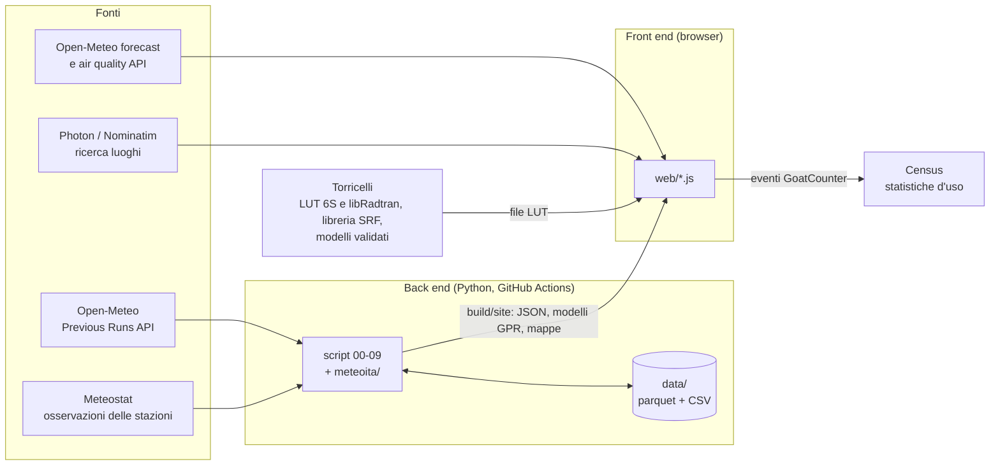
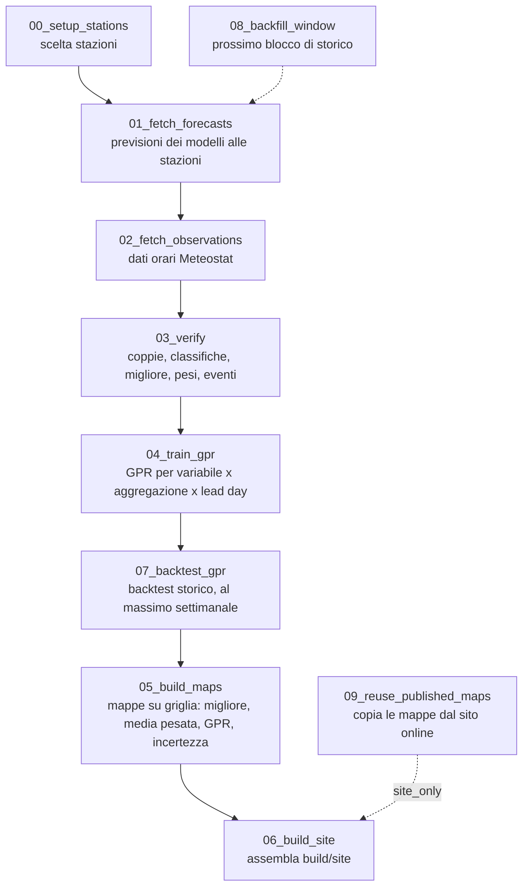
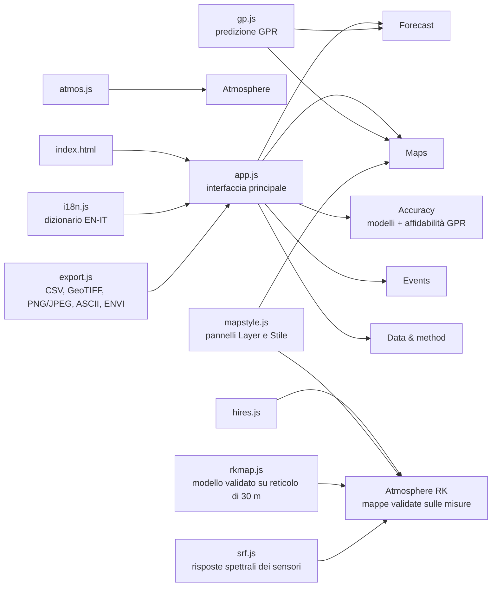
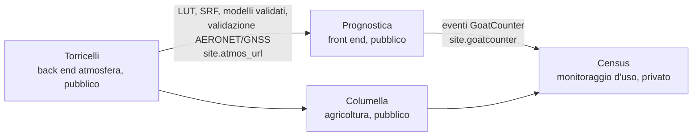

# Come funziona Prognostica

Prognostica è un sito statico pubblicato su GitHub Pages che fornisce una previsione meteo accurata per qualsiasi luogo.
Ogni modello Open-Meteo viene verificato sulle osservazioni delle stazioni. I modelli vengono poi combinati con una
regressione a processi gaussiani (GPR), che restituisce anche l'incertezza della previsione.
Il back end in Python gira su GitHub Actions; il front end in JavaScript esegue nel browser i calcoli rimanenti.

*Versione inglese: [HOW_IT_WORKS.md](HOW_IT_WORKS.md)*

## 1. Flusso dei dati

## 2. Script della pipeline 00-09

## 3. Schede e file JavaScript

Le schede sono in tre gruppi: previsione e sua verifica (Forecast, Maps, Accuracy, Events), atmosfera (Atmosphere, Atmosphere RK) e Data & method.

| Scheda | Cosa mostra | File |
|---|---|---|
| Forecast | Previsione GPR con incertezza e singoli modelli per il luogo scelto nella barra di ricerca (grafico e tabella scorrevoli) | `app.js`, `gp.js` |
| Atmosphere | Per una data e un'ora passate (archivio dei modelli, come per le immagini da correggere): riepilogo dell'ora, grafici (profilo verticale, giorno prima e dopo, spettro con spiegazioni al passaggio del mouse), modello di trasferimento radiativo (6S: solo VNIR–SWIR, parte termica ingrigita; libRadtran: VNIR–SWIR e LWIR), equazioni della radianza al sensore | `atmos.js` |
| Atmosphere RK | Vapore acqueo, AOD e grandezze di trasferimento radiativo ad alta risoluzione per una data e un'ora passate: ECMWF/CAMS corretti dal gradient boosting validato su AERONET e GNSS; banda di qualsiasi sensore tramite la sua risposta spettrale (libreria, metadati dell'immagine importata, personalizzata); griglia in un sistema di riferimento vero (UTM di default) o presa da un'immagine importata (GeoTIFF/COG, ENVI) pixel per pixel; download in GeoTIFF, PNG/JPEG + world file, griglia ASCII, ENVI, CSV, nelle unità del prodotto; mappa di validazione dei siti | `hires.js`, `rkmap.js`, `srf.js`, `mapstyle.js`, `export.js` |
| Maps | Mappe regionali: migliore, media pesata, GPR, incertezza, probabilità di pioggia; pannelli Layer e Stile | `app.js`, `mapstyle.js` |
| Accuracy | Errore di ogni modello per anticipo e andamento mensile; holdout e backtest storico del GPR | `app.js` |
| Events | Rilevamento di eventi di pioggia e temperatura (CSI) | `app.js` |
| Data & method | Download, metodo, crediti | `app.js` |

## 4. Collegamenti con Torricelli e Census

- **Torricelli** (`config.yaml → site.atmos_url`): `atmos.js` legge le tabelle 6S e libRadtran (copia locale di quelle 6S in `web/data/` come riserva), `srf.js` la libreria delle risposte spettrali `data/rt/srf.json`, `rkmap.js` i modelli `data/validation/rk_model_<var>.json`.
- **Validazione dell'aumento di risoluzione** (Torricelli `obs.yml`): misure orarie AERONET e GNSS (NGL), ECMWF/CAMS ai siti, terreno a 500/2000 m; il gradient boosting (scikit-learn) impara la correzione del modello da covariate che esistono per ogni pixel e ora, con eventuale kriging dei residui; ogni gruppo di celle di 0,5° è escluso a turno. Prognostica legge `data/validation/rk_validation.json`.
- **Dati atmosferici di partenza**: ECMWF IFS 0,25° (~25 km: vapore acqueo, pressione, temperatura) e CAMS globale 0,4° (~45 km: AOD 550 nm) da Open-Meteo, valore della cella di griglia di ogni punto. Le tabelle vengono interpolate in vapore acqueo, AOD, angolo zenitale solare e quota del suolo, e pesate con la risposta spettrale della banda scelta (tabelle ogni 10 nm nel VNIR–SWIR, ogni 0,1 µm nel termico).
- **Census** (`config.yaml → site.goatcounter`): `app.js` invia eventi anonimi senza cookie a GoatCounter, con prefisso `prognostica/`. Census li legge.

## 5. Workflow e orari (UTC)

```mermaid
gantt
  dateFormat HH:mm
  axisFormat %H:%M
  title Orari giornalieri (UTC)
  section daily.yml
  Aggiornamento giornaliero :06:17, 40m
  Riserva (solo se il mattino è fallito) :10:37, 40m
  section backfill_auto.yml
  Blocco di storico + backtest :13:43, 40m
```

| Workflow | Quando | Cosa fa |
|---|---|---|
| `daily.yml` | 06:17 UTC (riserva alle 10:37), cioè 07:17 o 08:17 ora italiana | Script 00 (solo al primo avvio), 01, 02, 03, 04, 07, 05, 06; salva i dati e pubblica il sito |
| `backfill_auto.yml` | 13:43 UTC | Ricostruisce un blocco di storico più vecchio (08 → 01 → 02 → 03) ed esegue il backtest 07 |
| `backfill.yml` | manuale, con date di inizio e fine | Ricostruisce un periodo di storico a scelta |
| `site_only.yml` | manuale | Ripubblica il sito senza chiamare le API meteo (03, 04, 07, 09, 06) |

## 6. File → cosa fa

| File | Cosa fa |
|---|---|
| `config.yaml` | Provider, regioni (Italia, RadCalNet, HYPERNETS), griglie, soglie degli eventi, impostazioni del sito |
| `scripts/00_setup_stations.py` | Sceglie stazioni Meteostat ben distribuite → `data/stations.csv` |
| `scripts/01_fetch_forecasts.py` | Scarica le previsioni dei modelli su stazioni e siti → `data/forecasts/` |
| `scripts/02_fetch_observations.py` | Scarica le osservazioni orarie → `data/observations/` |
| `scripts/03_verify.py` | Coppie previsione/osservazione, classifiche, migliore e pesi, eventi → `data/stats/`, `data/csv/`, JSON del sito |
| `scripts/04_train_gpr.py` | Addestra e valida i modelli GPR e li esporta in JSON per il browser |
| `scripts/05_build_maps.py` | Mappe di previsione su griglia regolare per ogni regione |
| `scripts/06_build_site.py` | Assembla `build/site` (file web, dati, `meta.json`, osservazioni recenti) |
| `scripts/07_backtest_gpr.py` | Backtest storico a finestre mobili del GPR, confrontato con modelli e combinazioni |
| `scripts/08_backfill_window.py` | Sceglie il prossimo blocco di storico da ricostruire (`data/backfill_state.json`) |
| `scripts/09_reuse_published_maps.py` | Copia le mappe dal sito online, senza chiamate alle API |
| `scripts/demo_generate.py` | Genera dati sintetici per provare tutta la catena senza connessione |
| `meteoita/config.py` | Legge `config.yaml` e definisce i percorsi comuni |
| `meteoita/providers.py` | Scarica le previsioni da Open-Meteo e dai provider opzionali |
| `meteoita/observations.py` | Stazioni e osservazioni Meteostat |
| `meteoita/verify.py` | Accoppiamento, aggregazione (1 h / 6 h / 24 h), punteggi |
| `meteoita/gp.py` | GPR: matrice di progetto, addestramento, export JSON, predizione |
| `meteoita/regions.py` | Regioni e siti puntuali |
| `meteoita/grid.py` | Griglie regolari per le mappe |
| `meteoita/events.py` | Rilevamento degli eventi e punteggi (POD, FAR, CSI) |
| `meteoita/storage.py` | Lettura e scrittura dei file parquet |
| `meteoita/demo.py` | Generatore di dati sintetici |
| `web/index.html` | Struttura della pagina e schede |
| `web/style.css` | Layout e stili |
| `web/app.js` | Interfaccia principale: Forecast, Maps, accuratezza, eventi, GPR, dati |
| `web/gp.js` | Predizione GPR nel browser (stessi risultati di Python) |
| `web/atmos.js` | Scheda Atmosphere; tabelle di trasferimento radiativo 6S e libRadtran (VNIR–SWIR, LWIR) |
| `web/hires.js` | Atmosphere RK: griglia (quadrato UTM o GeoTIFF/ENVI importato con lunghezze d'onda delle bande e ora di acquisizione), controlli, layer, download con unità, mappa di validazione |
| `web/mapstyle.js` | Simbologia delle mappe come in QGIS: pannello Layer (mostra/nascondi, ordine) e pannello Stile (scala di colori, min/max, classi, opacità, istogramma, legenda) |
| `web/export.js` | Download in tutte le schede: grafici e tabelle in CSV; mappe in GeoTIFF Float32, PNG/JPEG + world file, griglia ASCII ESRI, ENVI, CSV, nel sistema di riferimento della griglia |
| `web/rkmap.js` | Applica il gradient boosting validato su un reticolo di 30 m (ECMWF/CAMS all'ora, terreno, posizione, ora) e il trasferimento radiativo pixel per pixel |
| `web/srf.js` | Risposte spettrali: libreria, metadati dell'immagine (ENVI, GeoTIFF/GDAL), personalizzate; banda virtuale delle tabelle |
| `web/vendor/` | Leaflet, Chart.js, geotiff.js, proj4js (licenze in `LICENSES.md`) |
| `web/i18n.js` | Dizionario inglese → italiano |
| `tests/test_gp_consistency.py` | Controlla che sklearn, `meteoita.gp` e `web/gp.js` diano la stessa predizione GPR |

Aggiornare questo file e `HOW_IT_WORKS.md` quando cambia il funzionamento del progetto.
