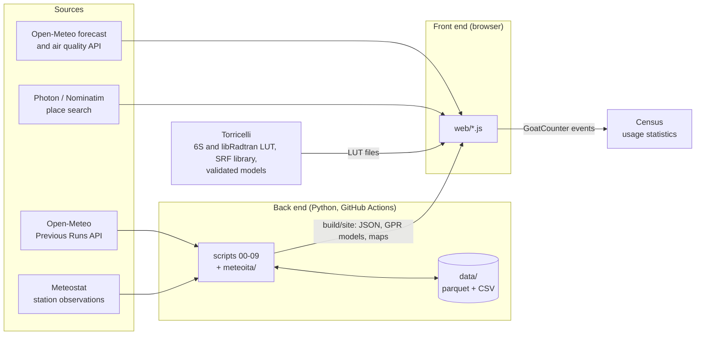
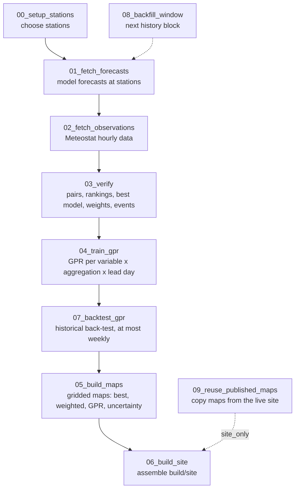
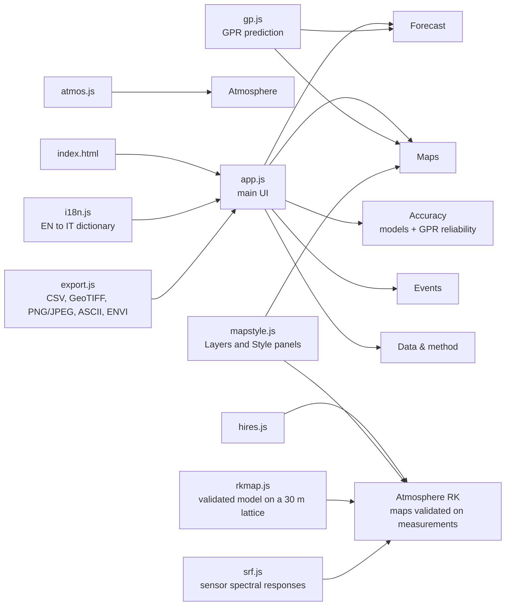
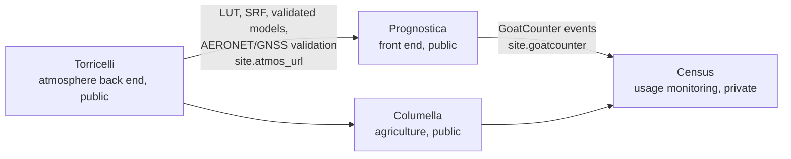

# How Prognostica works

Prognostica is a static website (GitHub Pages) that gives an accurate weather forecast for any place.
It checks every Open-Meteo model against station observations, then combines them with a Gaussian process
regression (GPR) model that also gives the uncertainty of the forecast.
The Python back end runs on GitHub Actions. The JavaScript front end does the remaining calculations in the browser.

*Italian version: [COME_FUNZIONA.md](COME_FUNZIONA.md)*

## 1. Data flow

## 2. Pipeline scripts 00-09

## 3. Tabs and JavaScript files

The tabs are in three groups: forecast and its verification (Forecast, Maps, Accuracy, Events), atmosphere (Atmosphere, Atmosphere RK) and Data & method.

| Tab | What it shows | File |
|---|---|---|
| Forecast | GPR forecast with uncertainty and the single models for the place chosen in the search bar (scrollable chart and table) | `app.js`, `gp.js` |
| Atmosphere | For a past date and hour (archive of the models, as for the images to correct): summary of the hour, charts (vertical profile, day before and after, VNIR–SWIR and LWIR spectra at the table resolution or in the bands of a sensor, with hover explanations), radiative transfer model (6S: VNIR–SWIR only, thermal part greyed out; libRadtran: VNIR–SWIR and LWIR), at-sensor radiance equations | `atmos.js` |
| Atmosphere RK | Water vapour, AOD and radiative transfer quantities at high resolution for a past date and hour: ECMWF/CAMS brought to high resolution by regression kriging (gradient boosting trend validated on AERONET and GNSS); band of any sensor through its spectral response (library, metadata of the imported image, custom); grid in a real CRS (UTM by default) or taken from an imported image (GeoTIFF/COG, ENVI) pixel by pixel; downloads in GeoTIFF, PNG/JPEG + world file, ASCII grid, ENVI, CSV, in the units of the product; validation map of the sites | `hires.js`, `rkmap.js`, `srf.js`, `mapstyle.js`, `export.js` |
| Maps | Regional maps: best model, weighted mean, GPR, uncertainty, rain probability; Layers and Style panels | `app.js`, `mapstyle.js` |
| Accuracy | Error of each model by lead time and monthly trend; GPR hold-out and historical back-test | `app.js` |
| Events | Detection of rain and temperature events (CSI) | `app.js` |
| Data & method | Downloads, method, credits | `app.js` |

## 4. Links with Torricelli and Census

- **Torricelli** (`config.yaml → site.atmos_url`): `atmos.js` reads the 6S and libRadtran look-up tables (local copy of the 6S ones in `web/data/` as a fallback), `srf.js` the spectral response library `data/rt/srf.json`, `rkmap.js` the models `data/validation/rk_model_<var>.json`.
- **Validation of the downscaling** (Torricelli `obs.yml`): hourly AERONET and GNSS (NGL) measurements, ECMWF/CAMS at the sites, terrain at 500/2000 m; gradient boosting (scikit-learn) learns the correction of the model from covariates that exist for every pixel and hour, optionally with kriging of the residuals; each group of 0.5° cells is left out in turn. Prognostica reads `data/validation/rk_validation.json`.
- **Atmospheric inputs**: ECMWF IFS 0.25° (~25 km: water vapour, pressure, temperature; archived from 3 February 2024, earlier dates use the ERA5 reanalysis at 0.25°) and CAMS global 0.4° (~45 km: AOD 550 nm) from Open-Meteo, value of the grid cell of each point. The look-up tables are interpolated in water vapour, AOD, solar zenith angle and ground elevation, and weighted with the spectral response of the chosen band (tables every 10 nm in VNIR–SWIR, every 0.1 µm in the thermal).
- **Census** (`config.yaml → site.goatcounter`): `app.js` sends anonymous, cookie-free GoatCounter events (path prefix `prognostica/`). Census reads them.

## 5. Workflows and schedule (UTC)

```mermaid
gantt
  dateFormat HH:mm
  axisFormat %H:%M
  title Daily schedule (UTC)
  section daily.yml
  Daily update        :06:17, 40m
  Reserve run (only if the morning failed) :10:37, 40m
  section backfill_auto.yml
  History block + back-test :13:43, 40m
```

| Workflow | When | What it does |
|---|---|---|
| `daily.yml` | 06:17 UTC (reserve 10:37) | Scripts 00 (first run only), 01, 02, 03, 04, 07, 05, 06; saves data and publishes the site |
| `backfill_auto.yml` | 13:43 UTC | Rebuilds one older block of history (08 → 01 → 02 → 03), back-test 07 |
| `backfill.yml` | manual, with start/end dates | Rebuilds a chosen period of history |
| `site_only.yml` | manual | Republishes without calling weather APIs (03, 04, 07, 09, 06) |

## 6. File → what it does

| File | What it does |
|---|---|
| `config.yaml` | Providers, regions (Italy, RadCalNet, HYPERNETS), grids, event thresholds, site settings |
| `scripts/00_setup_stations.py` | Chooses well-spread Meteostat stations → `data/stations.csv` |
| `scripts/01_fetch_forecasts.py` | Downloads model forecasts at stations and sites → `data/forecasts/` |
| `scripts/02_fetch_observations.py` | Downloads hourly observations → `data/observations/` |
| `scripts/03_verify.py` | Forecast/observation pairs, rankings (providers and combinations on the same days), best model and weights, events → `data/stats/`, `data/csv/`, site JSON |
| `scripts/04_train_gpr.py` | Trains and validates GPR models, exports them as JSON for the browser |
| `scripts/05_build_maps.py` | Forecast maps on a regular grid for each region |
| `scripts/06_build_site.py` | Assembles `build/site` (web files, data, `meta.json`, recent observations) |
| `scripts/07_backtest_gpr.py` | Rolling historical back-test of GPR against models and combinations |
| `scripts/08_backfill_window.py` | Chooses the next history block to rebuild (`data/backfill_state.json`) |
| `scripts/09_reuse_published_maps.py` | Copies maps from the live site (no API calls) |
| `scripts/demo_generate.py` | Synthetic data to try the whole chain offline |
| `meteoita/config.py` | Reads `config.yaml`, common paths |
| `meteoita/providers.py` | Forecast download from Open-Meteo and optional providers |
| `meteoita/observations.py` | Meteostat stations and observations |
| `meteoita/verify.py` | Pairing, aggregation (1 h / 6 h / 24 h), scores |
| `meteoita/gp.py` | GPR design matrix, fit, JSON export, prediction |
| `meteoita/regions.py` | Regions and point sites |
| `meteoita/grid.py` | Regular grids for the maps |
| `meteoita/events.py` | Event detection and scores (POD, FAR, CSI) |
| `meteoita/storage.py` | Reading/writing parquet files |
| `meteoita/demo.py` | Synthetic data generator |
| `web/index.html` | Page structure and tabs |
| `web/style.css` | Layout and styles |
| `web/app.js` | Main UI: Forecast, Maps, accuracy, events, GPR, data |
| `web/gp.js` | GPR prediction in the browser (same results as Python) |
| `web/atmos.js` | Atmosphere tab; 6S and libRadtran look-up tables (VNIR–SWIR, LWIR) |
| `web/hires.js` | Atmosphere RK: grid (UTM square or imported GeoTIFF/ENVI with band wavelengths and acquisition time), controls, layers, downloads with units, validation map |
| `web/mapstyle.js` | QGIS-like map symbology: Layers panel (show/hide, order) and Style panel (colour ramp, min/max, classes, opacity, histogram, legend) |
| `web/export.js` | Downloads in every tab: charts and tables as CSV; maps as GeoTIFF Float32, PNG/JPEG + world file, ESRI ASCII grid, ENVI, CSV, in the coordinate system of the grid |
| `web/rkmap.js` | Applies the validated gradient boosting on a 30 m lattice (ECMWF/CAMS at the hour, terrain, hour and season) and the radiative transfer pixel by pixel |
| `web/srf.js` | Spectral responses: library, image metadata (ENVI, GeoTIFF/GDAL), custom; virtual band of the look-up tables |
| `web/vendor/` | Leaflet, Chart.js, geotiff.js, proj4js (licences in `LICENSES.md`) |
| `web/i18n.js` | English → Italian dictionary |
| `tests/test_gp_consistency.py` | Checks that sklearn, `meteoita.gp` and `web/gp.js` give the same GPR prediction |

Keep this file and `COME_FUNZIONA.md` up to date when the way the project works changes.
