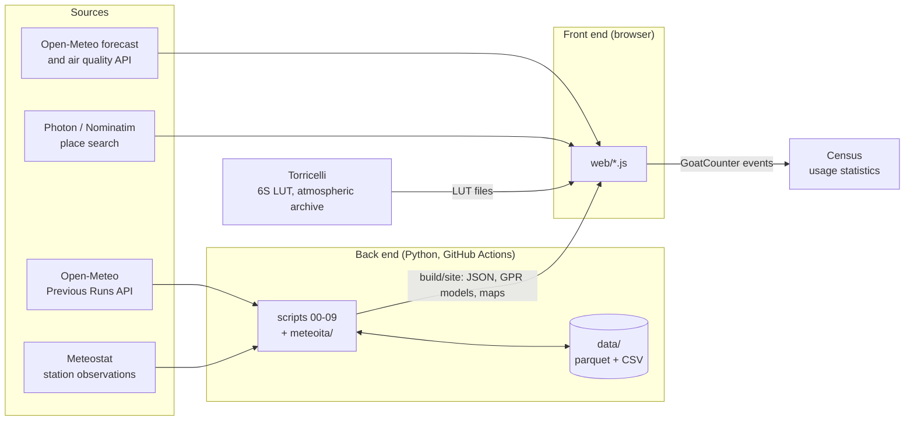
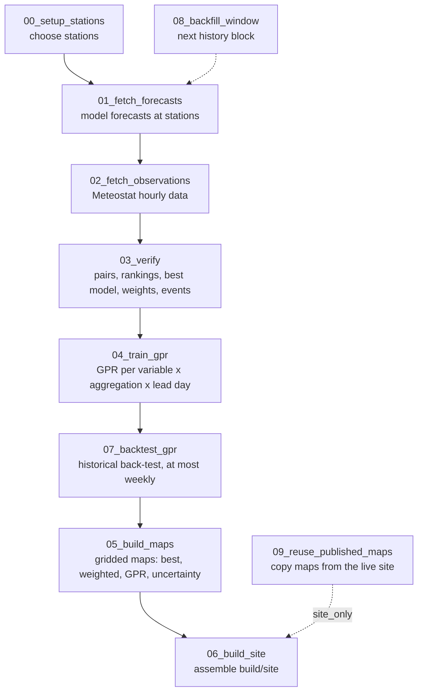
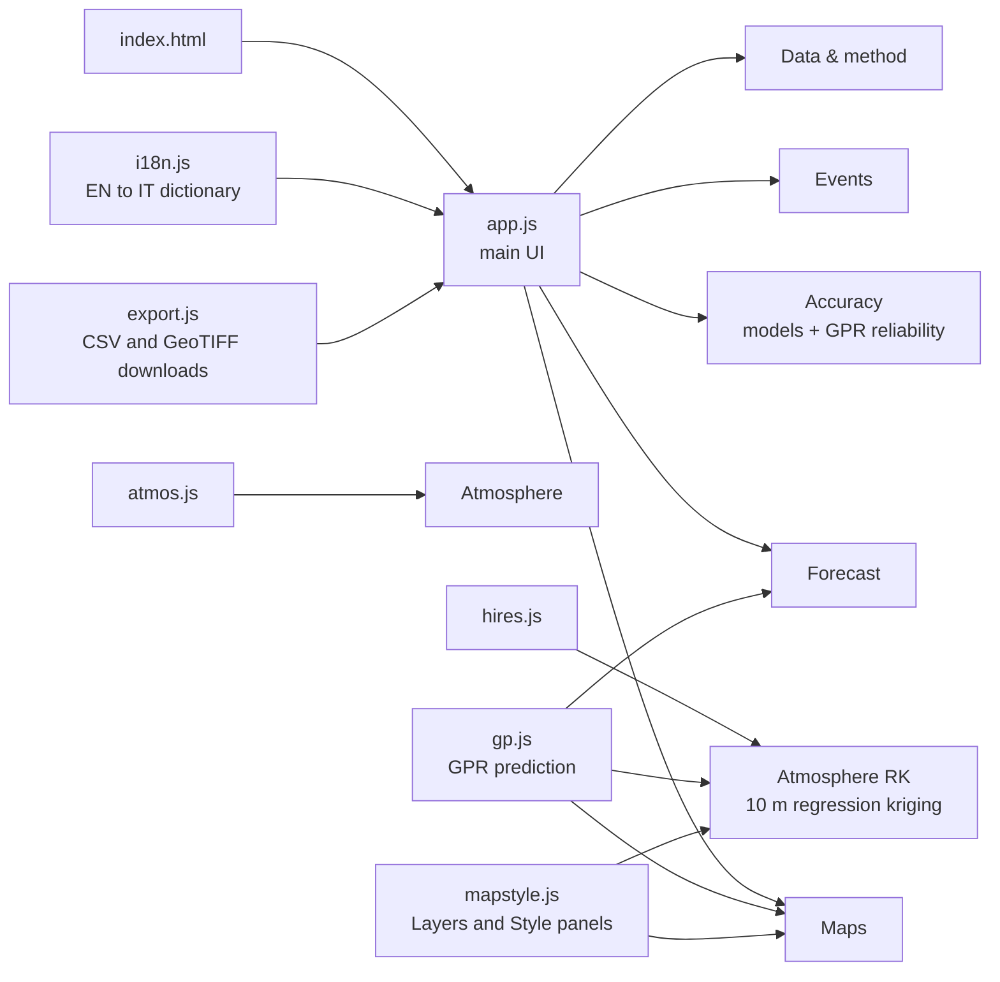
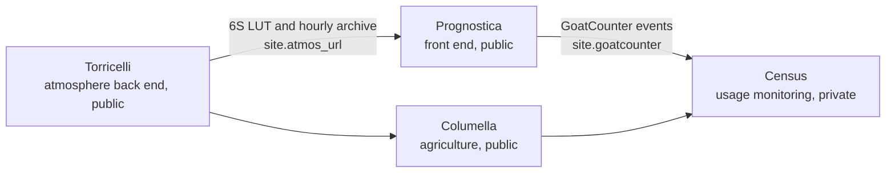

# How Prognostica works

Prognostica is a static website (GitHub Pages) that gives an accurate weather forecast for any place.
It checks every Open-Meteo model against station observations, then combines them with a Gaussian process
regression (GPR) model that also gives the uncertainty of the forecast.
The Python back end runs on GitHub Actions. The JavaScript front end does the remaining calculations in the browser.

*Italian version: [COME_FUNZIONA.md](COME_FUNZIONA.md)*

## 1. Data flow

## 2. Pipeline scripts 00-09

## 3. Tabs and JavaScript files

The tabs are in three groups: forecast and its verification (Forecast, Maps, Accuracy, Events), atmosphere (Atmosphere, Atmosphere RK) and Data & method.

| Tab | What it shows | File |
|---|---|---|
| Forecast | GPR forecast with uncertainty and the single models for the place chosen in the search bar (scrollable chart and table) | `app.js`, `gp.js` |
| Atmosphere | Summary of the hour, charts (vertical profile, next days, 6S spectrum with hover explanations), choice of the radiative transfer model, at-sensor radiance equations for VNIR–SWIR and LWIR | `atmos.js` |
| Atmosphere RK | Regression kriging map at 10 m with progress bar, leave-one-out validation points on the map, Layers and Style panels, GeoTIFF/CSV download | `hires.js`, `mapstyle.js`, `gp.js` |
| Maps | Regional maps: best model, weighted mean, GPR, uncertainty, rain probability; Layers and Style panels | `app.js`, `mapstyle.js` |
| Accuracy | Error of each model by lead time and monthly trend; GPR hold-out and historical back-test | `app.js` |
| Events | Detection of rain and temperature events (CSI) | `app.js` |
| Data & method | Downloads, method, credits | `app.js` |

## 4. Links with Torricelli and Census

- **Torricelli** (`config.yaml → site.atmos_url`): `atmos.js` reads the 6S look-up tables from Torricelli; if they are not available it uses the local copy in `web/data/`.
- **Atmospheric inputs**: ECMWF IFS 0.25° (~25 km: water vapour, pressure, temperature) and CAMS global 0.4° (~45 km: AOD 550 nm) from Open-Meteo, value of the grid cell of each point. The 6S look-up table is interpolated in water vapour, AOD, solar zenith angle and ground elevation.
- **Census** (`config.yaml → site.goatcounter`): `app.js` sends anonymous, cookie-free GoatCounter events (path prefix `prognostica/`). Census reads them.

## 5. Workflows and schedule (UTC)

```mermaid
gantt
  dateFormat HH:mm
  axisFormat %H:%M
  title Daily schedule (UTC)
  section daily.yml
  Daily update        :06:17, 40m
  Reserve run (only if the morning failed) :10:37, 40m
  section backfill_auto.yml
  History block + back-test :13:43, 40m
```

| Workflow | When | What it does |
|---|---|---|
| `daily.yml` | 06:17 UTC (reserve 10:37) | Scripts 00 (first run only), 01, 02, 03, 04, 07, 05, 06; saves data and publishes the site |
| `backfill_auto.yml` | 13:43 UTC | Rebuilds one older block of history (08 → 01 → 02 → 03), back-test 07 |
| `backfill.yml` | manual, with start/end dates | Rebuilds a chosen period of history |
| `site_only.yml` | manual | Republishes without calling weather APIs (03, 04, 07, 09, 06) |

## 6. File → what it does

| File | What it does |
|---|---|
| `config.yaml` | Providers, regions (Italy, RadCalNet, HYPERNETS), grids, event thresholds, site settings |
| `scripts/00_setup_stations.py` | Chooses well-spread Meteostat stations → `data/stations.csv` |
| `scripts/01_fetch_forecasts.py` | Downloads model forecasts at stations and sites → `data/forecasts/` |
| `scripts/02_fetch_observations.py` | Downloads hourly observations → `data/observations/` |
| `scripts/03_verify.py` | Forecast/observation pairs, rankings, best model and weights, events → `data/stats/`, `data/csv/`, site JSON |
| `scripts/04_train_gpr.py` | Trains and validates GPR models, exports them as JSON for the browser |
| `scripts/05_build_maps.py` | Forecast maps on a regular grid for each region |
| `scripts/06_build_site.py` | Assembles `build/site` (web files, data, `meta.json`, recent observations) |
| `scripts/07_backtest_gpr.py` | Rolling historical back-test of GPR against models and combinations |
| `scripts/08_backfill_window.py` | Chooses the next history block to rebuild (`data/backfill_state.json`) |
| `scripts/09_reuse_published_maps.py` | Copies maps from the live site (no API calls) |
| `scripts/demo_generate.py` | Synthetic data to try the whole chain offline |
| `meteoita/config.py` | Reads `config.yaml`, common paths |
| `meteoita/providers.py` | Forecast download from Open-Meteo and optional providers |
| `meteoita/observations.py` | Meteostat stations and observations |
| `meteoita/verify.py` | Pairing, aggregation (1 h / 6 h / 24 h), scores |
| `meteoita/gp.py` | GPR design matrix, fit, JSON export, prediction |
| `meteoita/regions.py` | Regions and point sites |
| `meteoita/grid.py` | Regular grids for the maps |
| `meteoita/events.py` | Event detection and scores (POD, FAR, CSI) |
| `meteoita/storage.py` | Reading/writing parquet files |
| `meteoita/demo.py` | Synthetic data generator |
| `web/index.html` | Page structure and tabs |
| `web/style.css` | Layout and styles |
| `web/app.js` | Main UI: Forecast, Maps, accuracy, events, GPR, data |
| `web/gp.js` | GPR prediction in the browser (same results as Python) |
| `web/atmos.js` | Atmosphere tab and 6S radiative transfer |
| `web/hires.js` | Atmosphere RK: 10 m regression kriging (values at 49–121 sample points from Open-Meteo + 6S, trend on elevation only, kriging of the residuals, leave-one-out validation) and GeoTIFF export |
| `web/mapstyle.js` | QGIS-like map symbology: Layers panel (show/hide, order) and Style panel (colour ramp, min/max, classes, opacity, histogram, legend) |
| `web/export.js` | Downloads in every tab: charts and tables as CSV, maps as GeoTIFF Float32 (EPSG:4326) |
| `web/i18n.js` | English → Italian dictionary |
| `tests/test_gp_consistency.py` | Checks that sklearn, `meteoita.gp` and `web/gp.js` give the same GPR prediction |

Keep this file and `COME_FUNZIONA.md` up to date when the way the project works changes.
